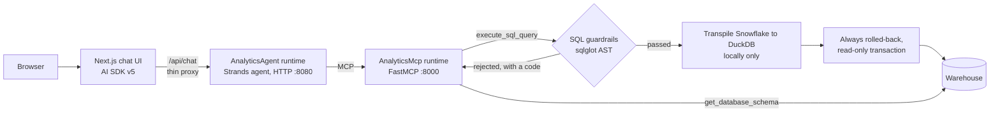

# Lumina Reach Analytics Agent

An AI analytics agent for a paid search agency network. Business users ask
questions in plain English: which channels really drive conversions, which
campaigns overspend their budget, whether Google or Microsoft is cheaper per
sale, where spend is wasted. The agent reads the warehouse schema, writes
Snowflake SQL, runs it read-only behind AST-level guardrails, and answers with
tables, charts or diagrams, plus the SQL it ran.

> Lumina Reach Media Group is a fictional agency network: 15 member agencies,
> 80 advertisers, Google Ads and Microsoft Advertising. All data is synthetic
> and generated by this repo.

## Architecture



Three processes, each with one job, and the same three run locally and on
[Amazon Bedrock AgentCore](https://aws.amazon.com/bedrock/agentcore/):

- **Web tier** (`app/api/chat/route.ts`, `lib/agent-proxy.ts`): forwards the
  chat request to the agent runtime and streams the answer back untouched. No
  Python and no credentials; an unreachable runtime becomes a readable answer.
- **Agent runtime** (`agent_app/runtimes/analytics_agent.py`): the AgentCore
  HTTP contract (`POST /invocations`, `GET /ping` on 8080). It takes the AI SDK
  request, builds a new agent for each turn from the history the client sends
  (no shared state between users), and answers in the AI SDK v5 UI message
  stream. It never opens a warehouse connection.
- **MCP runtime** (`agent_app/runtimes/analytics_mcp.py`): the AgentCore MCP
  contract (stateless streamable HTTP on 8000, `/mcp`), serving
  `get_database_schema` and `execute_sql_query`. The only process that holds
  warehouse credentials. Deployed, the agent signs its MCP calls with SigV4.

- **Warehouse:** a DuckDB file locally, for development, tests and evaluation;
  Snowflake when deployed (key-pair service user with a read-only role).
  `WAREHOUSE_ENGINE` switches between them. SQL is written in the Snowflake
  dialect everywhere. On DuckDB, sqlglot transpiles it just before it runs, so
  the prompt, the guardrails and the reference queries are written once.
  `mise run wh-snowflake-sync` copies the DuckDB file into Snowflake (tables,
  keys, views transpiled by sqlglot, every row count checked). It signs you in
  with a key pair of your own (no password) and sets the cost cap: an X-Small warehouse that
  suspends after 60 idle seconds, a 60-second statement timeout, and a resource
  monitor that suspends the warehouse at its monthly credit quota.
- **SQL guardrails** (`agent_app/nl2sql/guardrails.py`): every query is parsed
  into an AST and checked before it runs. Each rejection has a code and an
  actionable message the model uses to fix its own SQL:

  | Code | Rejects |
  | :--- | :--- |
  | `PARSE_ERROR`, `MULTI_STATEMENT` | invalid SQL, stacked statements |
  | `NOT_SELECT` | any write, DDL, `COPY`, `GRANT`, `CALL`, `SYSTEM$` function, at any depth |
  | `UNKNOWN_TABLE`, `UNKNOWN_COLUMN` | names outside the schema: invented fields never reach the warehouse |
  | `SENSITIVE_COLUMN` | contact data, including through `SELECT *` |
  | `CONVERSION_MIX` | adding conversions from two sources that count different things |
  | `RATIO_AVG` | `AVG` of a ratio or an impression share, instead of a sum over a sum |

  The guardrails also rewrite `CURRENT_DATE` to the data's reference date, and
  add a `LIMIT` when a query has none. The allowlist comes from schema
  reflection; the dataset-specific rules come from `data/sql-policy.toml`. So a
  dataset swap never edits `agent_app/`.
- **Defense in depth:** below the guardrails, every query runs in a transaction
  that is always rolled back, on a read-only DuckDB file or a `SELECT`-only
  Snowflake role.

## The dataset

`dataset/` holds the domain, all of it generated:

| File | What it is |
| :--- | :--- |
| `00-…_summary.md` | the network, the size, the five question categories |
| `01-…_business_context.md` | business model, industry primer, glossary, metric formulas |
| `02-…_er_document.md` | ER diagram, columns, join rules and DDL, rendered from the generator |
| `03-…_sql_queries.md` | 20 reference queries (Q1–Q20) in the Snowflake dialect, each one passing the guardrails |
| `04-…_data_generator.py` | the deterministic generator: 21 tables + 2 views, 557,614 rows at seed 42 |

The data is shaped around the traps real paid search analysis falls into:

- three conversion sources that must never be added together;
- versioned budgets that double-count under a plain join;
- broad-match overflow terms with no keyword;
- last-click attribution under-crediting upper-funnel channels;
- a simulated data-driven attribution model that must be labelled as such.

## Quick start

Requires [mise](https://mise.jdx.dev/) (it installs Python, Node.js, uv and pnpm).

```bash
mise run inst            # Python and Node.js dependencies
mise run gen-data        # build dataset/lumina_reach_paid_search.duckdb
mise run cli-check-content
mise run dev             # http://localhost:3000, plus the agent (8080) and MCP (8000) runtimes
```

`scripts/test_agent.py` asks the running agent runtime a question without the
browser.

The LLM provider is set by `LLM_PROVIDER` (`bedrock`, `anthropic`, `openai` or
`google`). The committed default is Bedrock. To use the Anthropic API, put this
in a git-ignored `.env`:

```bash
LLM_PROVIDER="anthropic"
ANTHROPIC_API_KEY="..."
```

## Deploy (Amazon Bedrock AgentCore)

One CDK stack (`agentcore/cdk/lib/cdk-stack.ts`), deployed by the AgentCore CLI:

| Resource | Inbound | Its IAM role may | Its IAM role may not |
| :--- | :--- | :--- | :--- |
| `AnalyticsMcp` runtime (the data tools) | SigV4 only | read the Snowflake key's SSM parameter | call any Bedrock model (explicit Deny) |
| `AnalyticsAgent` runtime (the agent) | a Cognito access token from the web client (JWT authorizer) | invoke `AnalyticsMcp` (`bind()`), call Bedrock, read/write the quota table | read the Snowflake key (explicit Deny) |
| Cognito user pool | managed login, code + PKCE | | |
| DynamoDB quota table | | | |

Each runtime gets only its own environment: the agent has no `SNOWFLAKE_*`
setting at all, and the MCP server gets the parameter's name, never the key.

```bash
mise run wh-snowflake-sync     # the warehouse
mise run snowflake-key-deploy  # the key, to SSM (writes to AWS)
mise run ac-check-wheels       # every dependency has a Linux aarch64 wheel
mise run ac-build              # package + synthesize, no AWS write
mise run ac-deploy             # writes to AWS
```

## Tests

```bash
mise run test-python     # 335 tests
mise run cov-python      # 99% line coverage of agent_app
mise run test-node       # the web tier's proxy
mise run build-web       # also validates data/site.toml against the UI
```

The guardrail tests use a fictional dataset, so they keep describing the
guardrails rather than any one domain.

## Status and roadmap

| Milestone | Scope | Status |
| :--- | :--- | :--- |
| M2a | the app on Lumina Reach data: DuckDB/Snowflake engines, guardrails, prompt, UI | done |
| M2b | split the agent and its tools: the agent as an AgentCore HTTP runtime, `get_database_schema` / `execute_sql_query` as an MCP server runtime, `/api/chat` as a thin proxy | done |
| M2c | deploy on Amazon Bedrock AgentCore: per-runtime IAM roles, Cognito JWT login forwarded from the UI, Snowflake key in SSM readable only by the MCP role, per-user quota | in progress: stack synthesizes; deploy next |
| M2d | evaluation: golden set from Q1–Q20 plus held-out paraphrases, result-level comparison on several seeds | planned |

## Credits

The app skeleton (Next.js chat UI, Strands agent wiring,
render blocks, content checks) started from
[learn_ba_agent_app_scaffold-project](https://github.com/evelindsayyy/learn_ba_agent_app_scaffold-project).
