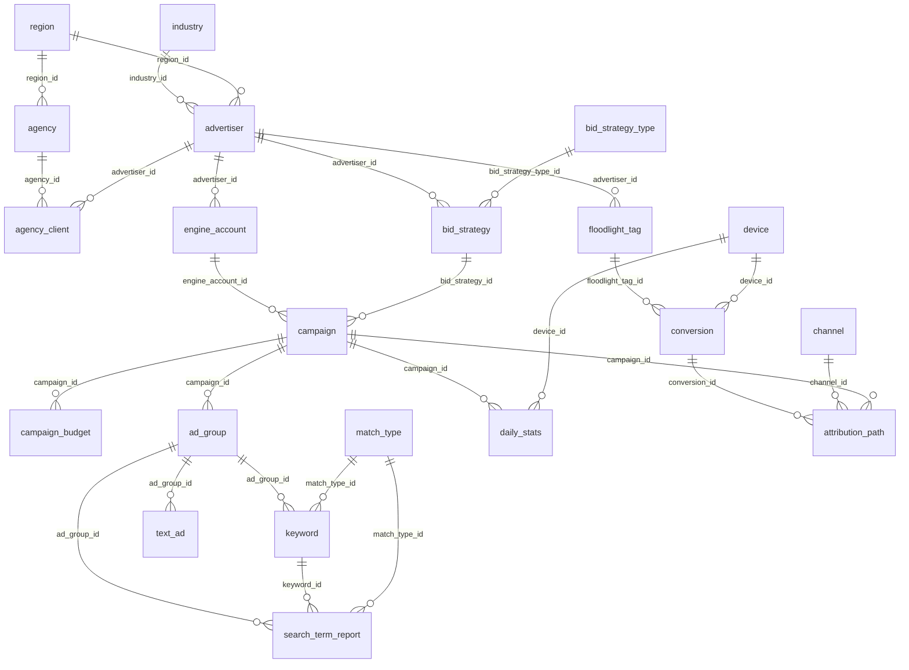

# Lumina Reach Paid Search: ER Document

The warehouse has 21 tables and 2 views, 557,614 rows at seed 42. Everything is in one schema, `lumina_reach`. The same DDL is used for the local DuckDB file and for Snowflake. Generated with `mise run gen-data` from `04-lumina_reach_paid_search_data_generator.py`.

Foreign keys are enforced in DuckDB. In Snowflake they are informational. Load order follows them (parents first).

## 1. Entity-relationship diagram



## 2. Tables

| Table | Kind | Rows | What one row is |
| :--- | :--- | ---: | :--- |
| `industry` | dimension | 10 | An IAB industry vertical of advertisers. |
| `region` | dimension | 9 | A US Census division where an agency or advertiser is based. |
| `bid_strategy_type` | dimension | 6 | A bidding strategy type. |
| `match_type` | dimension | 3 | A keyword match type. |
| `device` | dimension | 3 | A device class. |
| `channel` | dimension | 6 | A marketing channel of a touchpoint in a conversion path. |
| `agency` | organization | 15 | A member agency of the Lumina Reach network. |
| `advertiser` | organization | 80 | An advertiser brand whose paid search Lumina Reach reports on. |
| `agency_client` | organization | 64 | Which agency manages which advertiser, and its fee; about 80% of advertisers have one. |
| `engine_account` | structure | 144 | An advertiser's account on one search engine. |
| `bid_strategy` | structure | 240 | A portfolio bid strategy of an advertiser. |
| `campaign` | structure | 1,024 | A campaign in an engine account. |
| `campaign_budget` | structure | 1,890 | A version of a campaign's daily budget, valid from effective_date until the next version. A campaign can have several versions: join the version in effect on each report_date, never all of them. |
| `ad_group` | structure | 4,621 | An ad group of a campaign. |
| `keyword` | structure | 33,399 | A keyword bid in an ad group. |
| `text_ad` | structure | 18,550 | A text ad in an ad group. |
| `floodlight_tag` | structure | 400 | A Floodlight conversion tag of an advertiser, with its attribution lookback window. |
| `daily_stats` | fact | 164,796 | Engine-reported performance of one campaign on one device on one day. Its conversions are the ENGINE AGGREGATE source: never add or join them with the conversion table or search_term_report. |
| `conversion` | fact | 5,000 | One Floodlight conversion event (the FLOODLIGHT EVENT source), the subject of attribution. Never add these to daily_stats.conversions. |
| `attribution_path` | fact | 15,555 | One touchpoint of a conversion's path (2 to 6 touches), with the credit each of six attribution models gives it; the credits of one model sum to 1 over a conversion's path. Channel value under a model = SUM(credit * conversion.conversion_value). |
| `search_term_report` | fact | 311,799 | Performance of one search term in one ad group on one day (the SEARCH TERM source of conversions). keyword_id is NULL for broad-match overflow terms that matched no keyword of the ad group. |

### Views

| View | What it gives |
| :--- | :--- |
| `v_reference_date` | One row, `reference_date`: the last day of data (2026-07-13). Every relative window ends on it, never on the calendar date. |
| `mv_attribution_six_models` | `attribution_model`, `channel_name`, `attributed_value`, `attributed_conversions`: the value each channel earns under each of the six models (`last_click`, `first_click`, `linear`, `time_decay`, `position_based`, `data_driven_simulated`). |

## 3. Columns

### `industry`

An IAB industry vertical of advertisers.

| Column | Type | Notes |
| :--- | :--- | :--- |
| `industry_id` | INTEGER | Industry ID. (PK) |
| `industry_name` | VARCHAR | Industry name, such as Retail or B2B SaaS. |

### `region`

A US Census division where an agency or advertiser is based.

| Column | Type | Notes |
| :--- | :--- | :--- |
| `region_id` | INTEGER | Region ID. (PK) |
| `region_name` | VARCHAR | Region name, such as East North Central. |

### `bid_strategy_type`

A bidding strategy type.

| Column | Type | Notes |
| :--- | :--- | :--- |
| `bid_strategy_type_id` | INTEGER | Bid strategy type ID. (PK) |
| `type_name` | VARCHAR | Manual CPC, Enhanced CPC, Maximize Clicks, Maximize Conversions, Target CPA, or Target ROAS. |
| `is_smart_bidding` | BOOLEAN | Whether the engine sets bids automatically. |

### `match_type`

A keyword match type.

| Column | Type | Notes |
| :--- | :--- | :--- |
| `match_type_id` | INTEGER | Match type ID. (PK) |
| `match_type_name` | VARCHAR | Exact, Phrase, or Broad. |

### `device`

A device class.

| Column | Type | Notes |
| :--- | :--- | :--- |
| `device_id` | INTEGER | Device ID. (PK) |
| `device_name` | VARCHAR | Mobile, Desktop, or Tablet. |

### `channel`

A marketing channel of a touchpoint in a conversion path.

| Column | Type | Notes |
| :--- | :--- | :--- |
| `channel_id` | INTEGER | Channel ID. (PK) |
| `channel_name` | VARCHAR | Paid Search, Display, Paid Social, Email, Organic Search, or Direct. |
| `funnel_stage` | VARCHAR | upper, mid, or lower funnel. |

### `agency`

A member agency of the Lumina Reach network.

| Column | Type | Notes |
| :--- | :--- | :--- |
| `agency_id` | INTEGER | Agency ID. (PK) |
| `agency_name` | VARCHAR | Agency name. |
| `tier` | VARCHAR | Platinum, Gold, Silver, or Standard. |
| `region_id` | INTEGER | Region of the agency's head office. (FK → `region.region_id`) |
| `founded_year` | INTEGER | Year founded. |
| `contact_email` | VARCHAR | Business contact email. (**sensitive: never selected**) |
| `contact_phone` | VARCHAR | Business contact phone. (**sensitive: never selected**) |

### `advertiser`

An advertiser brand whose paid search Lumina Reach reports on.

| Column | Type | Notes |
| :--- | :--- | :--- |
| `advertiser_id` | INTEGER | Advertiser ID. (PK) |
| `advertiser_name` | VARCHAR | Brand name. |
| `industry_id` | INTEGER | Industry of the brand. (FK → `industry.industry_id`) |
| `region_id` | INTEGER | Region of the brand's head office. (FK → `region.region_id`) |
| `website_url` | VARCHAR | Brand website. (**sensitive: never selected**) |

### `agency_client`

Which agency manages which advertiser, and its fee; about 80% of advertisers have one.

| Column | Type | Notes |
| :--- | :--- | :--- |
| `agency_id` | INTEGER | Managing agency. (PK; FK → `agency.agency_id`) |
| `advertiser_id` | INTEGER | Managed advertiser. (PK; FK → `advertiser.advertiser_id`) |
| `start_date` | DATE | First day of the engagement. |
| `end_date` | DATE | Last day of the engagement; NULL while active. (nullable) |
| `fee_type` | VARCHAR | percentage or flat. |
| `fee_percentage` | DOUBLE | Fee as a fraction of managed spend (0.08 to 0.20); NULL for a flat fee. (nullable) |
| `annual_flat_fee` | DOUBLE | Yearly flat fee in USD; NULL for a percentage fee. (nullable) |
| `is_active` | INTEGER | 1 if the engagement is current, else 0. Portfolio questions filter is_active = 1. |

### `engine_account`

An advertiser's account on one search engine.

| Column | Type | Notes |
| :--- | :--- | :--- |
| `engine_account_id` | INTEGER | Engine account ID. (PK) |
| `advertiser_id` | INTEGER | Owning advertiser. (FK → `advertiser.advertiser_id`) |
| `engine` | VARCHAR | Google Ads or Microsoft Advertising. |
| `account_name` | VARCHAR | Account name. |

### `bid_strategy`

A portfolio bid strategy of an advertiser.

| Column | Type | Notes |
| :--- | :--- | :--- |
| `bid_strategy_id` | INTEGER | Bid strategy ID. (PK) |
| `advertiser_id` | INTEGER | Owning advertiser. (FK → `advertiser.advertiser_id`) |
| `bid_strategy_type_id` | INTEGER | Its type. (FK → `bid_strategy_type.bid_strategy_type_id`) |
| `strategy_name` | VARCHAR | Strategy name. |
| `target_cpa` | DOUBLE | Target cost per acquisition in USD; set only for Target CPA strategies. (nullable) |
| `target_roas` | DOUBLE | Target return on ad spend (value / cost); set only for Target ROAS strategies. (nullable) |

### `campaign`

A campaign in an engine account.

| Column | Type | Notes |
| :--- | :--- | :--- |
| `campaign_id` | INTEGER | Campaign ID. (PK) |
| `engine_account_id` | INTEGER | Engine account. (FK → `engine_account.engine_account_id`) |
| `bid_strategy_id` | INTEGER | Bid strategy in use. (FK → `bid_strategy.bid_strategy_id`) |
| `campaign_name` | VARCHAR | Campaign name. |
| `campaign_type` | VARCHAR | Search, Shopping, or Display. |
| `status` | VARCHAR | Enabled or Paused. |
| `start_date` | DATE | Launch date. |

### `campaign_budget`

A version of a campaign's daily budget, valid from effective_date until the next version. A campaign can have several versions: join the version in effect on each report_date, never all of them.

| Column | Type | Notes |
| :--- | :--- | :--- |
| `budget_id` | INTEGER | Budget version ID. (PK) |
| `campaign_id` | INTEGER | Campaign. (FK → `campaign.campaign_id`) |
| `daily_budget` | DOUBLE | Daily budget in USD. |
| `effective_date` | DATE | First day this version applies. |

### `ad_group`

An ad group of a campaign.

| Column | Type | Notes |
| :--- | :--- | :--- |
| `ad_group_id` | INTEGER | Ad group ID. (PK) |
| `campaign_id` | INTEGER | Campaign. (FK → `campaign.campaign_id`) |
| `ad_group_name` | VARCHAR | Ad group name. |
| `status` | VARCHAR | Enabled or Paused. |

### `keyword`

A keyword bid in an ad group.

| Column | Type | Notes |
| :--- | :--- | :--- |
| `keyword_id` | INTEGER | Keyword ID. (PK) |
| `ad_group_id` | INTEGER | Ad group. (FK → `ad_group.ad_group_id`) |
| `keyword_text` | VARCHAR | Keyword text. |
| `match_type_id` | INTEGER | Match type. (FK → `match_type.match_type_id`) |
| `max_cpc` | DOUBLE | Max cost per click bid in USD. |
| `quality_score` | INTEGER | Engine quality score, 1 to 10. |
| `status` | VARCHAR | Enabled or Paused. |

### `text_ad`

A text ad in an ad group.

| Column | Type | Notes |
| :--- | :--- | :--- |
| `ad_id` | INTEGER | Ad ID. (PK) |
| `ad_group_id` | INTEGER | Ad group. (FK → `ad_group.ad_group_id`) |
| `headline` | VARCHAR | Headline. |
| `description` | VARCHAR | Description line. |
| `status` | VARCHAR | Enabled or Paused. |

### `floodlight_tag`

A Floodlight conversion tag of an advertiser, with its attribution lookback window.

| Column | Type | Notes |
| :--- | :--- | :--- |
| `floodlight_tag_id` | INTEGER | Tag ID. (PK) |
| `advertiser_id` | INTEGER | Advertiser. (FK → `advertiser.advertiser_id`) |
| `tag_name` | VARCHAR | Tag name. |
| `conversion_category` | VARCHAR | Purchase, Lead, Sign-up, or Booking. |
| `lookback_window_days` | INTEGER | Attribution lookback window: 30, 60, or 90 days. |

### `daily_stats`

Engine-reported performance of one campaign on one device on one day. Its conversions are the ENGINE AGGREGATE source: never add or join them with the conversion table or search_term_report.

| Column | Type | Notes |
| :--- | :--- | :--- |
| `report_date` | DATE | Day. (PK) |
| `campaign_id` | INTEGER | Campaign. (PK; FK → `campaign.campaign_id`) |
| `device_id` | INTEGER | Device. (PK; FK → `device.device_id`) |
| `impressions` | INTEGER | Impressions. |
| `clicks` | INTEGER | Clicks. |
| `cost` | DOUBLE | Spend in USD. |
| `conversions` | DOUBLE | Engine-reported conversions (engine aggregate source). |
| `conversion_value` | DOUBLE | Engine-reported conversion value in USD. |
| `search_impression_share` | DOUBLE | Share of eligible impressions won, 0 to 1; Search campaigns only. (nullable) |
| `search_top_impression_share` | DOUBLE | Share shown at the top of the page, 0 to 1; Search campaigns only. Weight by impressions when aggregating. (nullable) |
| `search_lost_is_budget` | DOUBLE | Impression share lost to budget, 0 to 1; Search campaigns only. (nullable) |
| `search_lost_is_rank` | DOUBLE | Impression share lost to ad rank, 0 to 1; Search campaigns only. (nullable) |

### `conversion`

One Floodlight conversion event (the FLOODLIGHT EVENT source), the subject of attribution. Never add these to daily_stats.conversions.

| Column | Type | Notes |
| :--- | :--- | :--- |
| `conversion_id` | INTEGER | Conversion ID. (PK) |
| `floodlight_tag_id` | INTEGER | Tag that fired. (FK → `floodlight_tag.floodlight_tag_id`) |
| `conversion_time` | TIMESTAMP | When it happened. |
| `conversion_value` | DOUBLE | Value in USD. |
| `device_id` | INTEGER | Device of the converting session. (FK → `device.device_id`) |

### `attribution_path`

One touchpoint of a conversion's path (2 to 6 touches), with the credit each of six attribution models gives it; the credits of one model sum to 1 over a conversion's path. Channel value under a model = SUM(credit * conversion.conversion_value).

| Column | Type | Notes |
| :--- | :--- | :--- |
| `conversion_id` | INTEGER | Conversion. (PK; FK → `conversion.conversion_id`) |
| `touch_index` | INTEGER | Position in the path, 1 = first touch. (PK) |
| `path_length` | INTEGER | Number of touches in this path. |
| `channel_id` | INTEGER | Channel of the touch. (FK → `channel.channel_id`) |
| `campaign_id` | INTEGER | Paid search campaign of the touch; NULL for other channels. (FK → `campaign.campaign_id`; nullable) |
| `touch_time` | TIMESTAMP | When the touch happened. |
| `last_click_credit` | DOUBLE | Last-click credit: 1 on the last touch. |
| `first_click_credit` | DOUBLE | First-click credit: 1 on the first touch. |
| `linear_credit` | DOUBLE | Linear credit: 1 / path_length on every touch. |
| `time_decay_credit` | DOUBLE | Time-decay credit: 7-day half-life before the conversion. |
| `position_credit` | DOUBLE | Position-based credit: 40% first, 40% last, 20% spread over the middle (50/50 for 2 touches). |
| `data_driven_credit` | DOUBLE | Data-driven credit: a NON-PRODUCTION SIMULATION, illustrative only; always say so. |

### `search_term_report`

Performance of one search term in one ad group on one day (the SEARCH TERM source of conversions). keyword_id is NULL for broad-match overflow terms that matched no keyword of the ad group.

| Column | Type | Notes |
| :--- | :--- | :--- |
| `report_date` | DATE | Day. (PK) |
| `ad_group_id` | INTEGER | Ad group. (PK; FK → `ad_group.ad_group_id`) |
| `keyword_id` | INTEGER | Keyword that matched; NULL for broad-match overflow. (FK → `keyword.keyword_id`; nullable) |
| `search_term` | VARCHAR | What the user searched. (PK) |
| `match_type_id` | INTEGER | Match type that served the ad. (FK → `match_type.match_type_id`) |
| `impressions` | INTEGER | Impressions. |
| `clicks` | INTEGER | Clicks. |
| `cost` | DOUBLE | Spend in USD. |
| `conversions` | DOUBLE | Conversions credited to the search term (search term source). |

## 4. Relationships and join rules

- **Advertiser hierarchy:** `advertiser` → `engine_account` → `campaign` → `ad_group` → `keyword` / `text_ad`. Spend reaches an advertiser through `daily_stats.campaign_id` → `campaign.engine_account_id` → `engine_account.advertiser_id`.
- **Agency relationship:** `agency_client` is the bridge from `agency` to `advertiser`. Portfolio questions use only current engagements (`is_active = 1`). About a quarter of advertisers have no active engagement and are self-managed, so join with `LEFT JOIN`.
- **Budgets are versioned:** `campaign_budget` holds several versions per campaign. For a day `d`, the budget is the version with the latest `effective_date <= d` (a correlated subquery with `ORDER BY effective_date DESC LIMIT 1`). A plain join counts every version.
- **Grain of `daily_stats`:** campaign × device × day. Counting campaigns or advertisers over it needs `COUNT(DISTINCT ...)`. Comparing spend to a daily budget needs it summed to campaign × day first.
- **Broad-match overflow:** `search_term_report.keyword_id` is NULL when a broad-match term matched no keyword of the ad group. Keep those rows with `LEFT JOIN keyword`.
- **Attribution:** `attribution_path` has one row per touch of a Floodlight `conversion` (2 to 6 touches). Each model's credits sum to 1 over a conversion. A channel's value under a model is `SUM(credit * conversion.conversion_value)`.
- **Three conversion sources, never combined:** `daily_stats.conversions` / `conversion_value` (engine aggregate), the `conversion` table plus `attribution_path` (Floodlight events), and `search_term_report.conversions` (search term aggregate). The SQL guardrails reject a query that mixes them.
- **Impression shares** (`search_*` columns of `daily_stats`) exist only for Search campaigns. Aggregate them weighted by impressions.

## 5. DDL

```sql
CREATE SCHEMA lumina_reach;

CREATE TABLE lumina_reach.industry (
    industry_id BIGINT NOT NULL,
    industry_name VARCHAR NOT NULL,
    PRIMARY KEY (industry_id)
);

CREATE TABLE lumina_reach.region (
    region_id BIGINT NOT NULL,
    region_name VARCHAR NOT NULL,
    PRIMARY KEY (region_id)
);

CREATE TABLE lumina_reach.bid_strategy_type (
    bid_strategy_type_id BIGINT NOT NULL,
    type_name VARCHAR NOT NULL,
    is_smart_bidding BOOLEAN NOT NULL,
    PRIMARY KEY (bid_strategy_type_id)
);

CREATE TABLE lumina_reach.match_type (
    match_type_id BIGINT NOT NULL,
    match_type_name VARCHAR NOT NULL,
    PRIMARY KEY (match_type_id)
);

CREATE TABLE lumina_reach.device (
    device_id BIGINT NOT NULL,
    device_name VARCHAR NOT NULL,
    PRIMARY KEY (device_id)
);

CREATE TABLE lumina_reach.channel (
    channel_id BIGINT NOT NULL,
    channel_name VARCHAR NOT NULL,
    funnel_stage VARCHAR NOT NULL,
    PRIMARY KEY (channel_id)
);

CREATE TABLE lumina_reach.agency (
    agency_id BIGINT NOT NULL,
    agency_name VARCHAR NOT NULL,
    tier VARCHAR NOT NULL,
    region_id BIGINT NOT NULL,
    founded_year BIGINT NOT NULL,
    contact_email VARCHAR NOT NULL,
    contact_phone VARCHAR NOT NULL,
    PRIMARY KEY (agency_id),
    FOREIGN KEY (region_id) REFERENCES lumina_reach.region(region_id)
);

CREATE TABLE lumina_reach.advertiser (
    advertiser_id BIGINT NOT NULL,
    advertiser_name VARCHAR NOT NULL,
    industry_id BIGINT NOT NULL,
    region_id BIGINT NOT NULL,
    website_url VARCHAR NOT NULL,
    PRIMARY KEY (advertiser_id),
    FOREIGN KEY (industry_id) REFERENCES lumina_reach.industry(industry_id),
    FOREIGN KEY (region_id) REFERENCES lumina_reach.region(region_id)
);

CREATE TABLE lumina_reach.agency_client (
    agency_id BIGINT NOT NULL,
    advertiser_id BIGINT NOT NULL,
    start_date DATE NOT NULL,
    end_date DATE,
    fee_type VARCHAR NOT NULL,
    fee_percentage DOUBLE,
    annual_flat_fee DOUBLE,
    is_active BIGINT NOT NULL,
    PRIMARY KEY (agency_id, advertiser_id),
    FOREIGN KEY (agency_id) REFERENCES lumina_reach.agency(agency_id),
    FOREIGN KEY (advertiser_id) REFERENCES lumina_reach.advertiser(advertiser_id)
);

CREATE TABLE lumina_reach.engine_account (
    engine_account_id BIGINT NOT NULL,
    advertiser_id BIGINT NOT NULL,
    engine VARCHAR NOT NULL,
    account_name VARCHAR NOT NULL,
    PRIMARY KEY (engine_account_id),
    FOREIGN KEY (advertiser_id) REFERENCES lumina_reach.advertiser(advertiser_id)
);

CREATE TABLE lumina_reach.bid_strategy (
    bid_strategy_id BIGINT NOT NULL,
    advertiser_id BIGINT NOT NULL,
    bid_strategy_type_id BIGINT NOT NULL,
    strategy_name VARCHAR NOT NULL,
    target_cpa DOUBLE,
    target_roas DOUBLE,
    PRIMARY KEY (bid_strategy_id),
    FOREIGN KEY (advertiser_id) REFERENCES lumina_reach.advertiser(advertiser_id),
    FOREIGN KEY (bid_strategy_type_id) REFERENCES lumina_reach.bid_strategy_type(bid_strategy_type_id)
);

CREATE TABLE lumina_reach.campaign (
    campaign_id BIGINT NOT NULL,
    engine_account_id BIGINT NOT NULL,
    bid_strategy_id BIGINT NOT NULL,
    campaign_name VARCHAR NOT NULL,
    campaign_type VARCHAR NOT NULL,
    status VARCHAR NOT NULL,
    start_date DATE NOT NULL,
    PRIMARY KEY (campaign_id),
    FOREIGN KEY (engine_account_id) REFERENCES lumina_reach.engine_account(engine_account_id),
    FOREIGN KEY (bid_strategy_id) REFERENCES lumina_reach.bid_strategy(bid_strategy_id)
);

CREATE TABLE lumina_reach.campaign_budget (
    budget_id BIGINT NOT NULL,
    campaign_id BIGINT NOT NULL,
    daily_budget DOUBLE NOT NULL,
    effective_date DATE NOT NULL,
    PRIMARY KEY (budget_id),
    FOREIGN KEY (campaign_id) REFERENCES lumina_reach.campaign(campaign_id)
);

CREATE TABLE lumina_reach.ad_group (
    ad_group_id BIGINT NOT NULL,
    campaign_id BIGINT NOT NULL,
    ad_group_name VARCHAR NOT NULL,
    status VARCHAR NOT NULL,
    PRIMARY KEY (ad_group_id),
    FOREIGN KEY (campaign_id) REFERENCES lumina_reach.campaign(campaign_id)
);

CREATE TABLE lumina_reach.keyword (
    keyword_id BIGINT NOT NULL,
    ad_group_id BIGINT NOT NULL,
    keyword_text VARCHAR NOT NULL,
    match_type_id BIGINT NOT NULL,
    max_cpc DOUBLE NOT NULL,
    quality_score BIGINT NOT NULL,
    status VARCHAR NOT NULL,
    PRIMARY KEY (keyword_id),
    FOREIGN KEY (ad_group_id) REFERENCES lumina_reach.ad_group(ad_group_id),
    FOREIGN KEY (match_type_id) REFERENCES lumina_reach.match_type(match_type_id)
);

CREATE TABLE lumina_reach.text_ad (
    ad_id BIGINT NOT NULL,
    ad_group_id BIGINT NOT NULL,
    headline VARCHAR NOT NULL,
    description VARCHAR NOT NULL,
    status VARCHAR NOT NULL,
    PRIMARY KEY (ad_id),
    FOREIGN KEY (ad_group_id) REFERENCES lumina_reach.ad_group(ad_group_id)
);

CREATE TABLE lumina_reach.floodlight_tag (
    floodlight_tag_id BIGINT NOT NULL,
    advertiser_id BIGINT NOT NULL,
    tag_name VARCHAR NOT NULL,
    conversion_category VARCHAR NOT NULL,
    lookback_window_days BIGINT NOT NULL,
    PRIMARY KEY (floodlight_tag_id),
    FOREIGN KEY (advertiser_id) REFERENCES lumina_reach.advertiser(advertiser_id)
);

CREATE TABLE lumina_reach.daily_stats (
    report_date DATE NOT NULL,
    campaign_id BIGINT NOT NULL,
    device_id BIGINT NOT NULL,
    impressions BIGINT NOT NULL,
    clicks BIGINT NOT NULL,
    cost DOUBLE NOT NULL,
    conversions DOUBLE NOT NULL,
    conversion_value DOUBLE NOT NULL,
    search_impression_share DOUBLE,
    search_top_impression_share DOUBLE,
    search_lost_is_budget DOUBLE,
    search_lost_is_rank DOUBLE,
    PRIMARY KEY (report_date, campaign_id, device_id),
    FOREIGN KEY (campaign_id) REFERENCES lumina_reach.campaign(campaign_id),
    FOREIGN KEY (device_id) REFERENCES lumina_reach.device(device_id)
);

CREATE TABLE lumina_reach.conversion (
    conversion_id BIGINT NOT NULL,
    floodlight_tag_id BIGINT NOT NULL,
    conversion_time TIMESTAMP NOT NULL,
    conversion_value DOUBLE NOT NULL,
    device_id BIGINT NOT NULL,
    PRIMARY KEY (conversion_id),
    FOREIGN KEY (floodlight_tag_id) REFERENCES lumina_reach.floodlight_tag(floodlight_tag_id),
    FOREIGN KEY (device_id) REFERENCES lumina_reach.device(device_id)
);

CREATE TABLE lumina_reach.attribution_path (
    conversion_id BIGINT NOT NULL,
    touch_index BIGINT NOT NULL,
    path_length BIGINT NOT NULL,
    channel_id BIGINT NOT NULL,
    campaign_id BIGINT,
    touch_time TIMESTAMP NOT NULL,
    last_click_credit DOUBLE NOT NULL,
    first_click_credit DOUBLE NOT NULL,
    linear_credit DOUBLE NOT NULL,
    time_decay_credit DOUBLE NOT NULL,
    position_credit DOUBLE NOT NULL,
    data_driven_credit DOUBLE NOT NULL,
    PRIMARY KEY (conversion_id, touch_index),
    FOREIGN KEY (conversion_id) REFERENCES lumina_reach.conversion(conversion_id),
    FOREIGN KEY (channel_id) REFERENCES lumina_reach.channel(channel_id),
    FOREIGN KEY (campaign_id) REFERENCES lumina_reach.campaign(campaign_id)
);

CREATE TABLE lumina_reach.search_term_report (
    report_date DATE NOT NULL,
    ad_group_id BIGINT NOT NULL,
    keyword_id BIGINT,
    search_term VARCHAR NOT NULL,
    match_type_id BIGINT NOT NULL,
    impressions BIGINT NOT NULL,
    clicks BIGINT NOT NULL,
    cost DOUBLE NOT NULL,
    conversions DOUBLE NOT NULL,
    PRIMARY KEY (report_date, ad_group_id, search_term),
    FOREIGN KEY (ad_group_id) REFERENCES lumina_reach.ad_group(ad_group_id),
    FOREIGN KEY (keyword_id) REFERENCES lumina_reach.keyword(keyword_id),
    FOREIGN KEY (match_type_id) REFERENCES lumina_reach.match_type(match_type_id)
);

CREATE VIEW lumina_reach.v_reference_date AS SELECT MAX(report_date) AS reference_date FROM lumina_reach.daily_stats;

CREATE VIEW lumina_reach.mv_attribution_six_models AS SELECT 'last_click' AS attribution_model, ch.channel_name, SUM(ap.last_click_credit * c.conversion_value) AS attributed_value, SUM(ap.last_click_credit) AS attributed_conversions FROM lumina_reach.attribution_path ap JOIN lumina_reach.conversion c ON c.conversion_id = ap.conversion_id JOIN lumina_reach.channel ch ON ch.channel_id = ap.channel_id GROUP BY ch.channel_name UNION ALL SELECT 'first_click' AS attribution_model, ch.channel_name, SUM(ap.first_click_credit * c.conversion_value) AS attributed_value, SUM(ap.first_click_credit) AS attributed_conversions FROM lumina_reach.attribution_path ap JOIN lumina_reach.conversion c ON c.conversion_id = ap.conversion_id JOIN lumina_reach.channel ch ON ch.channel_id = ap.channel_id GROUP BY ch.channel_name UNION ALL SELECT 'linear' AS attribution_model, ch.channel_name, SUM(ap.linear_credit * c.conversion_value) AS attributed_value, SUM(ap.linear_credit) AS attributed_conversions FROM lumina_reach.attribution_path ap JOIN lumina_reach.conversion c ON c.conversion_id = ap.conversion_id JOIN lumina_reach.channel ch ON ch.channel_id = ap.channel_id GROUP BY ch.channel_name UNION ALL SELECT 'time_decay' AS attribution_model, ch.channel_name, SUM(ap.time_decay_credit * c.conversion_value) AS attributed_value, SUM(ap.time_decay_credit) AS attributed_conversions FROM lumina_reach.attribution_path ap JOIN lumina_reach.conversion c ON c.conversion_id = ap.conversion_id JOIN lumina_reach.channel ch ON ch.channel_id = ap.channel_id GROUP BY ch.channel_name UNION ALL SELECT 'position_based' AS attribution_model, ch.channel_name, SUM(ap.position_credit * c.conversion_value) AS attributed_value, SUM(ap.position_credit) AS attributed_conversions FROM lumina_reach.attribution_path ap JOIN lumina_reach.conversion c ON c.conversion_id = ap.conversion_id JOIN lumina_reach.channel ch ON ch.channel_id = ap.channel_id GROUP BY ch.channel_name UNION ALL SELECT 'data_driven_simulated' AS attribution_model, ch.channel_name, SUM(ap.data_driven_credit * c.conversion_value) AS attributed_value, SUM(ap.data_driven_credit) AS attributed_conversions FROM lumina_reach.attribution_path ap JOIN lumina_reach.conversion c ON c.conversion_id = ap.conversion_id JOIN lumina_reach.channel ch ON ch.channel_id = ap.channel_id GROUP BY ch.channel_name;

```

## 6. Data generation rules

The data is synthetic and deterministic (seed 42 unless `--seed` is given). The generator is the source of truth; these are the facts it is shaped to carry:

- **Time:** `daily_stats` and `search_term_report` cover 62 days ending on the reference date 2026-07-13. Floodlight conversions cover 90 days.
- **Network:** 15 agencies (2 Platinum, 4 Gold, 5 Silver, 4 Standard), 80 advertisers in 10 industries, each with a Google Ads and often a Microsoft Advertising account.
- **Engines:** Microsoft CPC is about 80% of Google's and its conversion rate about 12% lower, so the two CPAs end up close.
- **Devices:** Mobile takes about 60% of impressions, Desktop about 32% and Tablet about 8%. Desktop has the highest conversion rate and the lowest CPA.
- **Industries:** each has its own average order value and CPC level (Restaurants and Retail are cheap and low-value; B2B SaaS and Real Estate are expensive and high-value).
- **Budgets:** campaigns have one to several budget versions; spend is drawn around the budget in effect, and Search campaigns lose impression share to budget when it binds.
- **Keywords:** quality score 1 to 10; low scores raise CPC. A share of search terms are broad-match overflow with no keyword.
- **Attribution:** 5,000 conversions with path lengths 2 to 6 weighted [40, 30, 15, 10, 5]; upper-funnel channels (Display, Paid Social) tend to open paths and lower-funnel ones to close them, so last-click under-credits them. Every touch falls inside its tag's lookback window (30, 60 or 90 days). `data_driven_credit` is a simulation, not a fitted model.
